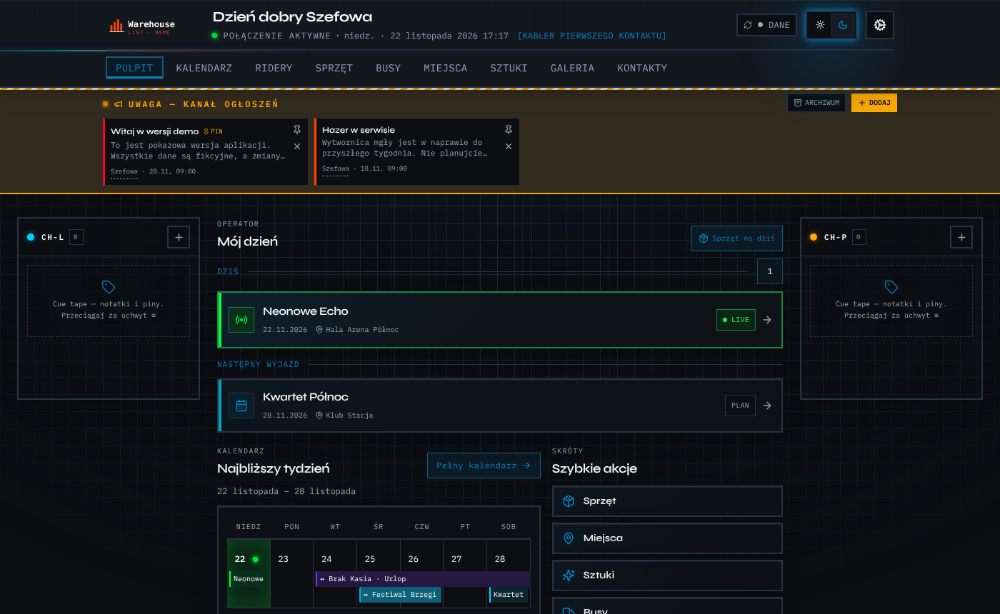
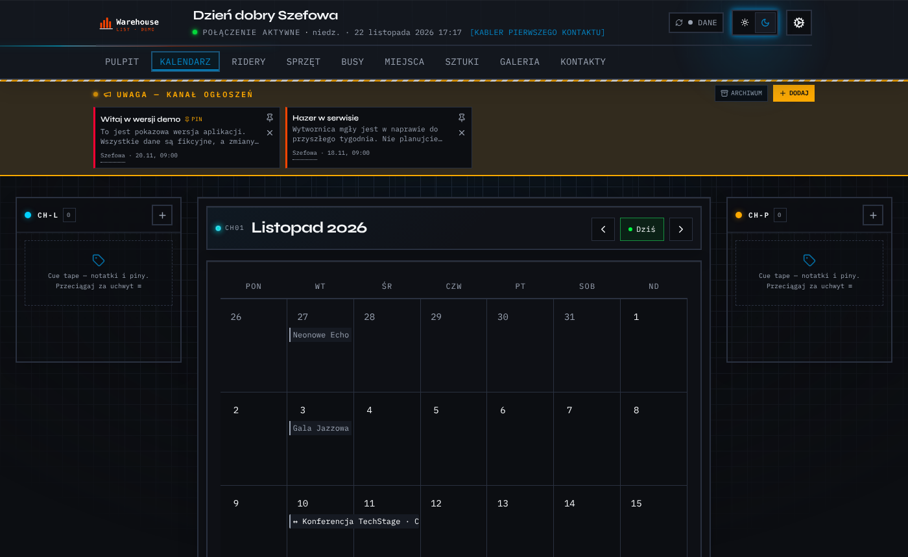
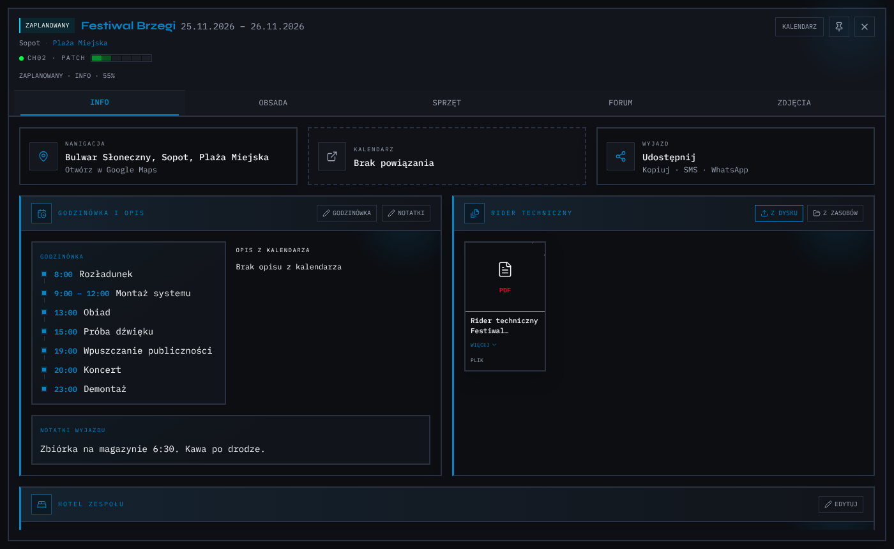
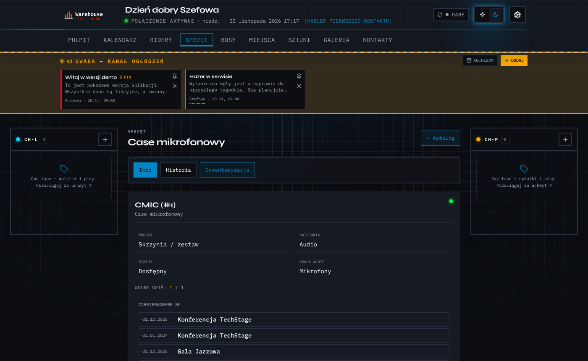
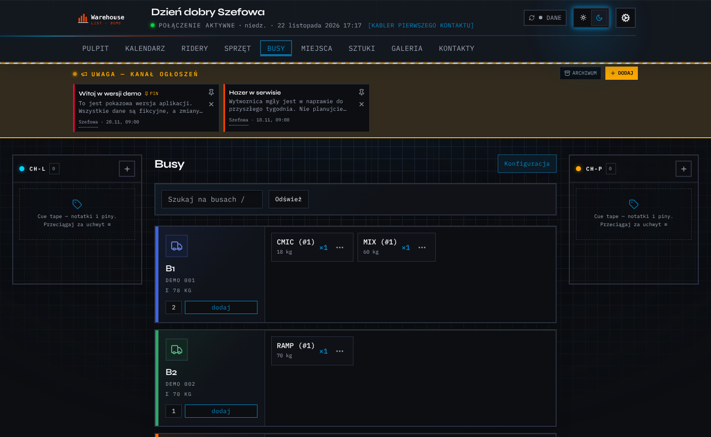

# WarehouseList (demo)

A showcase build of an operations app I designed for a live-events technical crew: the people who load the trucks, rig the PA and run the shows.
It answers the questions a crew asks every day: *where are we going, who is on the team, and what goes on the bus?*

**Live demo:** https://maclak01.github.io/warehouse-list-demo/
Click **"Wejdź jako administrator"** or **"Wejdź jako technik"** on the login screen. No account needed.

> This is a demo. It runs entirely in your browser on fictional sample data.
> There is no backend: every person, venue, company and phone number is made up,
> and anything you change is stored only in your browser's localStorage.
> The UI is in Polish, as is the production app.

## What it does

| Area | Ideas implemented |
| --- | --- |
| **Calendar** | Month and week views of events, multi-day bars, crew unavailability, status per event (planned, in progress, done). |
| **Event card** | Daily schedule parsed from free text, trip notes, team hotel, technical rider files, discussion thread, photo tab. |
| **Staffing** | Required headcount per role and phase (rig / show / strike), sign-up and acceptance flow, conflict detection with other events and time off. |
| **Equipment catalog** | Cases with a bill of materials (BOM), pooled vs. serial-numbered items, stock reservation per date, damaged / away / rented states. |
| **Kit builder & packing** | Assign cases and loose items to an event, mark them packed and loaded, track incomplete cases. |
| **Buses** | Live view of which case sits on which vehicle, with total weight. |
| **Inventory** | Per-case checklist to verify that the BOM matches reality. |
| **Venues & shows** | Profiles with travel distance, sticky notes ("bring a 50 m extension"), hotel and food tips. |
| **Gallery** | Photos from past trips grouped by month. |
| **Notices & forum** | Pinned announcements and an ideas / problems board with admin replies. |
| **Admin panel** | Users and roles, equipment catalog editor, venues, shows, vehicles, notices, audit log. |

| | |
| --- | --- |
|  |  |
|  |  |

## Tech stack

- React 19, TypeScript, Vite
- Tailwind CSS with a custom "rack panel" design system (dark and light theme)
- React Router, React Hook Form + Zod, Zustand, dnd-kit
- PWA (installable, works on phones in the venue)

The production version runs on a hosted Postgres backend with row-level security, auth and file storage.
This public demo replaces that layer with an in-browser data store seeded with fictional data, so the app can be clicked through without an account.

This repository contains only the compiled demo (in [`docs/`](docs), served by GitHub Pages), screenshots and this description.
The source code is private.

## License

Copyright (c) 2026 MacLak01. **All rights reserved.**
The demo is shared for viewing only. You may not use, copy, modify or distribute it, or any part of it, without written permission. See [LICENSE](LICENSE).

## About

Designed and built by [@MacLak01](https://github.com/MacLak01) together with AI coding assistants.
